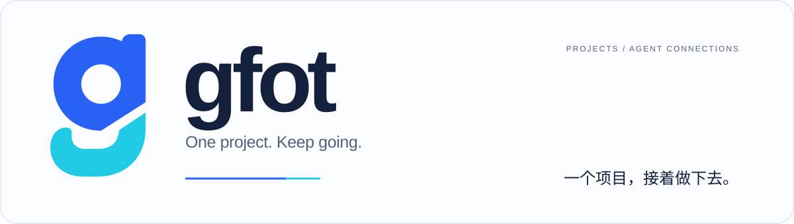
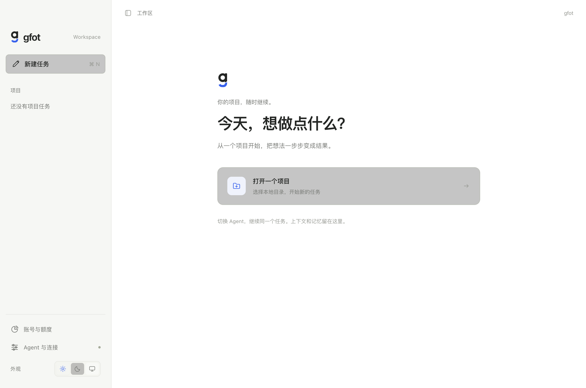
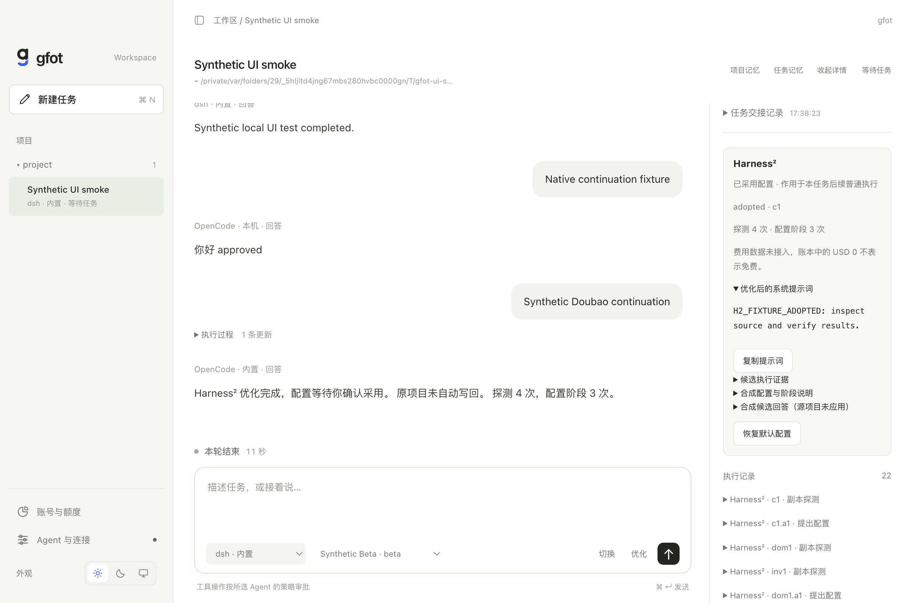

<div align="center">



**面向本地 AI 编程任务的桌面客户端。**

本地 Agent 执行、共享任务上下文与个人账号管理。

[English](README.md) · **简体中文**


[](LICENSE)

[项目介绍](#项目介绍) · [账号接入](#账号与服务) · [Harness²](#harness²) · [安装](#安装)

</div>

<br />

<picture>
  <source media="(prefers-color-scheme: dark)" srcset="docs/desktop-preview-dark.png" />
  
</picture>

## 项目介绍

gfot 用于管理本地项目中的 AI 编程任务，将项目目录、任务对话、执行记录与账号连接集中在一个客户端。切换执行器时保存进度，在同一个项目和任务中继续工作。

- **围绕项目组织任务。** 选择本地目录，按任务保存对话与执行记录。
- **运行本机 Agent。** 默认由内置 DeepSeek Harness（dsh）执行。保留 OpenCode 以继续已有任务，也可通过 ACP 调用已安装的 OpenCode、WorkBuddy、WorkBuddy AI CLI。豆包桌面端提供实验性原生接入。本机执行器使用各自的登录与额度。
- **使用自己的账号。** 为 dsh 接入已有 Codex 登录、API、本机模型服务或兼容代理；在回合之间切换模型或账号，保留同一个 dsh 会话。在“账号与额度”中查看凭证状态及已支持的用量窗口。
- **切换 Agent，继续原任务。** 保留项目目录与对话，交接项目记忆、工具结果和工作区状态；遇到额度限制可选择其他执行器继续。
- **看清执行过程。** 实时查看思考状态、工具活动和授权请求；过程更新默认收起，回答支持标题、列表和代码复制。
- **优化执行配置。** 使用 Harness² 在项目副本中评估指令配置，选择采用结果用于后续执行。

在侧栏切换浅色、深色或跟随系统，外观偏好保存在本机。

## 账号与服务

| 接入方式 | 配置方式 |
| --- | --- |
| **Codex 本地登录** | 导入选定的 `auth.json`，将访问凭证副本加密保存在本机。 |
| **模型 API** | 配置接口地址与 API Key，支持 Chat Completions、Responses 和 Anthropic 协议。 |
| **本机模型** | 连接 Ollama 或运行在本机的其他兼容服务。 |
| **本地代理** | 连接兼容代理地址，包括通过 CC Switch 配置的路由。 |

Codex 凭证导入为实验功能。各项连接使用已有服务权限与账号额度，兼容性说明见[账号与认证](docs/accounts.md)。

## Harness²

`h2` 分支集成 Google Harness²，提供任务级指令配置优化：

1. 在独立项目副本中运行基线与候选配置。
2. 根据执行证据合成指令配置。
3. 查看结果，选择用于同一任务的后续回合，或保留现有配置。



优化功能需要 **Python 3.12 或 3.13**，会进行多次模型调用。探测产生的修改不会自动合并回原项目。执行限制与配置范围见 [Harness² 接入文档](docs/h2-integration.md)。

## 安装

需要 **Apple silicon Mac、Node.js 22.12+ 和 npm**。普通任务无需 Python。

```sh
git clone --branch h2 https://github.com/Wayneway26/gfot.git
cd gfot
npm ci
node node_modules/electron/install.js
npm run runtime:dsh
npm run desktop
```

### 使用

1. 打开 **Agent 选择**，检查本机 Agent 并完成 CLI 登录，或为内置 dsh 配置模型连接。
2. 新建任务，选择项目目录并输入指令。
3. 执行过程中审批工具请求。更换连接前，先结束或停止当前回合，再选择其他执行器或连接。

### 构建

```sh
npm run dist:mac
```

生成的 `.app` 和 ZIP 位于 `dist/`。预览版构建尚未签名或通过 Apple 公证。

## 架构

| 组件 | 职责 |
| --- | --- |
| **gfot · Electron / Node.js** | 桌面界面、任务持久化、账号管理、本地代理与审批处理。 |
| **DeepSeek Harness · dsh** | 默认执行循环、原生工具、会话和子 Agent，通过 stdio JSON-RPC 接入 gfot 的审批与反问。 |
| **其他执行适配层 · HTTP / ACP** | 保留已有 OpenCode 会话，并接入本机 Agent CLI。 |
| **Harness² · Python 适配层** | 可选的任务级指令配置探测、提案与合成流程。 |

执行器选择用于切换 Agent；模型连接选择用于配置所选内置引擎。dsh 中切换模型或账号会保留原生会话；选择外部本机 Agent 时使用其自身执行流程。豆包工作已提供实验性原生接入，每轮授权后执行；尚未适配原生交互确认。千问办公目前仅支持安装检测。[适配范围与验证记录](docs/local-agents.md) · [动态切换](docs/dynamic-switching.md)。

凭证在本机加密保存，主密钥由 macOS 钥匙串保护。对话和执行记录保存在本机，所配置的模型服务会接收请求所需上下文。工具审批属于应用层控制，不是操作系统沙箱。

## 文档

[dsh 执行引擎](docs/dsh-integration.md) · [本地 Agent](docs/local-agents.md) · [桌面版指南](docs/desktop-preview.md) · [账号与代理](docs/accounts.md) · [Harness² 接入](docs/h2-integration.md) · [验证记录](docs/verification.md)

## 参与贡献

通过 [GitHub Issues](https://github.com/Wayneway26/gfot/issues) 提交问题与兼容性报告，请附上应用版本、连接类型及脱敏后的错误信息，避免上传凭证或私密对话记录。欢迎提交 Pull Request。

## 致谢

[Electron](https://github.com/electron/electron) · [DeepSeek Harness](https://github.com/deepseek-ai/deepseek-harness) · [OpenCode](https://github.com/anomalyco/opencode) · [Google Harness²](https://github.com/google-research/harness2) · [CC Switch](https://github.com/farion1231/cc-switch)

## 许可证

[Apache-2.0](LICENSE)。依赖许可证见[第三方声明](THIRD_PARTY_NOTICES.md)。
